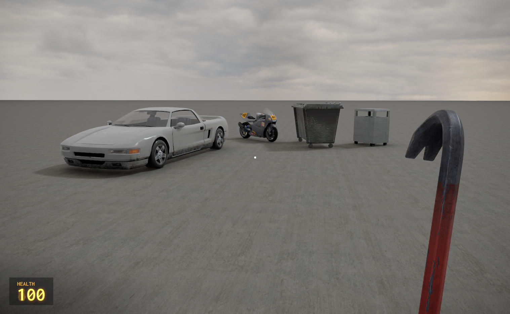
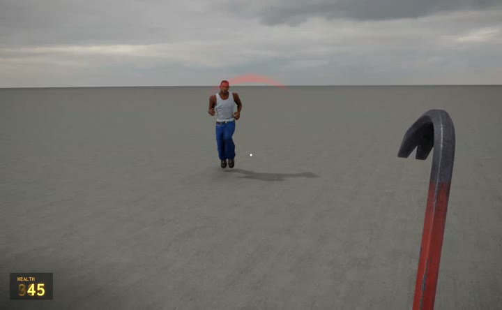
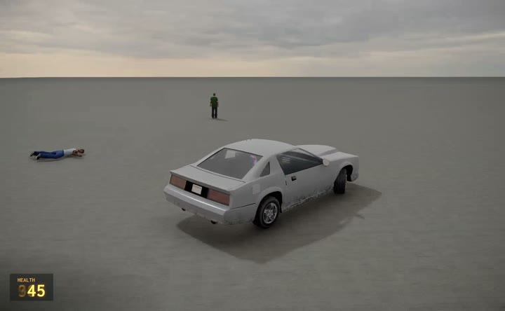
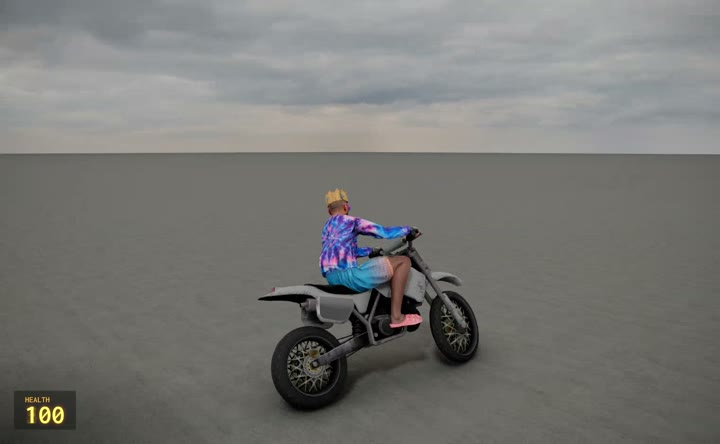
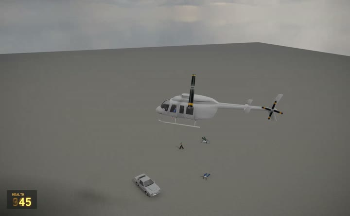
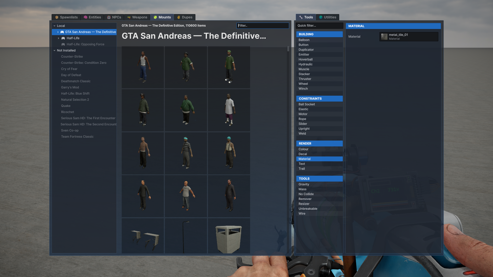

# GTA San Andreas — The Definitive Edition mount for s&box

Browse GTA San Andreas models, textures, sounds, and animations directly in s&box. Open Sandbox's **Mounts** tab to spawn characters, props and playable vehicles from your installed game.

We mount the Definitive Edition because the original San Andreas was delisted from Steam.

## Install

You need s&box and GTA San Andreas — The Definitive Edition installed through Steam.

1. **[Download sade-mount.zip — v0.1](https://github.com/crosschainer/sade-mount/releases/download/v0.1/sade-mount.zip)**.
2. Close s&box.
3. Extract the ZIP into s&box's `mount` folder. The result should be `sbox/mount/sade/sade.dll`.
4. Launch s&box and activate **GTA San Andreas — The Definitive Edition** in **Mounts**.

To find the s&box folder, right-click it in Steam and choose **Manage → Browse local files**. The mount finds your GTA installation automatically.

When updating, close s&box and replace the `sade` folder with the new release. Keep `sade.json` if you have customized it. No SDK or build tools are needed to use a release.

[Release notes and downloads](https://github.com/crosschainer/sade-mount/releases/tag/v0.1)



## See it in Sandbox

Click a preview to download the MP4 recording.

| Pedestrians and gang fights · 47 seconds | Car driving · 8 seconds |
| --- | --- |
| [](https://raw.githubusercontent.com/crosschainer/sade-mount/main/docs/videos/pedestrians.mp4) | [](https://raw.githubusercontent.com/crosschainer/sade-mount/main/docs/videos/car-driving.mp4) |
| **Motorcycle riding · 8 seconds** | **Helicopter flight · 25 seconds** |
| [](https://raw.githubusercontent.com/crosschainer/sade-mount/main/docs/videos/motorcycle-riding.mp4) | [](https://raw.githubusercontent.com/crosschainer/sade-mount/main/docs/videos/helicopter-flight.mp4) |

## What's included

- A featured collection with recognizable characters and useful assets near the top.
- Static and skeletal models, textures, materials, and authored collision.
- Sound effects, dialogue, radio tracks, and animation banks.
- Animated pedestrians, with gang members that fight rivals and retaliate when attacked.
- Original character voices for nearby greetings, gang fights and reactions.
- Limb-by-limb physgun posing, using Sandbox's normal grab and freeze controls.
- The full GTA weapon roster, with original models, animations, sounds and bullet tracers for NPC fights.
- Cars, motorcycles, bicycles, boats, helicopters and planes with enterable seats.
- Original engine sounds with changing revs, gear shifts and throttle response.

Assets load when needed and are reused on subsequent loads. Navigation-enabled maps let NPCs move around obstacles. Without navigation, they remain in place with their idle animation.

Grove Street, Ballas, Vagos, Aztecas, Rifa, Triads, Da Nang Boys and Mafia use their original affiliations. CJ, Big Smoke and other featured characters appear first, with weapon loadouts alongside the regular models. Spawning a character or vehicle from Sandbox's Mounts tab activates its behavior automatically.



Grab an NPC's arm, leg or body with the physgun to switch it into a poseable ragdoll. It stays in pose mode so frozen limbs keep their positions. Spawn another copy when you want an active NPC again.

Near a vehicle, press **E** on the left side to drive, or on the right side to take an available passenger seat. Press **E** again to exit.

| Vehicle | Controls |
| --- | --- |
| Cars and bikes | W accelerate, S brake/reverse, A/D steer, Space handbrake |
| Boats | W/S throttle, A/D steer |
| Helicopters | W/S climb and descend, A/D yaw, arrow keys pitch and roll |
| Planes | W/S increase and decrease throttle, A/D yaw, arrow keys pitch and roll |

Vehicle handling uses the original handling data with an arcade physics adapter. Trains, trailers and RC vehicles are available as models. Full-world loading, missions and vehicle combat are outside this release. Materials are translated into s&box shaders, so some Unreal effects look different.

## Settings

Settings are optional. To override the game location or cache folder, create `mount/sade/sade.json`:

```json
{
  "GameDirectory": "D:\\Games\\GTA San Andreas - The Definitive Edition",
  "CacheDirectory": "D:\\Caches\\sade-mount",
  "RegisterAnimationVariants": true,
  "LodDistance": 2000
}
```

The default cache is `%LOCALAPPDATA%\sade-mount\cache`. Restart s&box after changing settings. If an asset cannot load, its source path and the reason appear in the console.

## Building from source

Install the .NET 10 SDK, then run these commands from the repository in PowerShell:

```powershell
.\scripts\Build.ps1
.\scripts\Install.ps1 -SkipBuild
.\scripts\Release.ps1 -SkipBuild
```

The scripts use `FACEPUNCH_ENGINE` or Steam's default s&box folder. Pass `-SboxDirectory 'D:\SteamLibrary\steamapps\common\sbox'` to choose another installation. `-DotnetPath` selects a specific `dotnet.exe`.

Build output is `.artifacts/package/sade`; the release ZIP is `.artifacts/sade-mount.zip`. Rebuild after s&box API updates. Game data and the game's decoder stay in the GTA installation; they are not included in the package.

To prepare the demo project:

```powershell
.\scripts\Setup-Demo.ps1
```

Open `Demo/sade_preview/sade_preview.sbproj` in s&box.

## Development

`src/Sade.Mount` creates s&box resources and runs NPC and vehicle behavior. `src/Sade.Reader` reads Unreal packages in an isolated assembly context. `src/Sade.Contracts` defines the shared data types; `src/Sade.Formats` reads classic GTA animation and collision formats. No project helper or engine modification is needed.

Resources use `mount://sade/` paths. The `models`, `materials`, `textures`, and `sounds` folders preserve the source hierarchy. `animations` contains model variants with compatible clips. `pedestrians` and `vehicles` also provide prefabs for scene editing.

Missing or malformed authored collision is reported by source asset. Aircraft with empty PhysicsAssets use reported convex collision derived from their intact mesh. Weapon projectile flight, area effects and vehicle physics use s&box implementations.

The native mounting structure takes inspiration from [K3rhos/alan_wake](https://github.com/K3rhos/alan_wake). See [third-party notices](THIRD-PARTY-NOTICES.md) for dependencies and source credits.

[Validation notes](docs/validation.md) describe the checks and remaining limitations.
