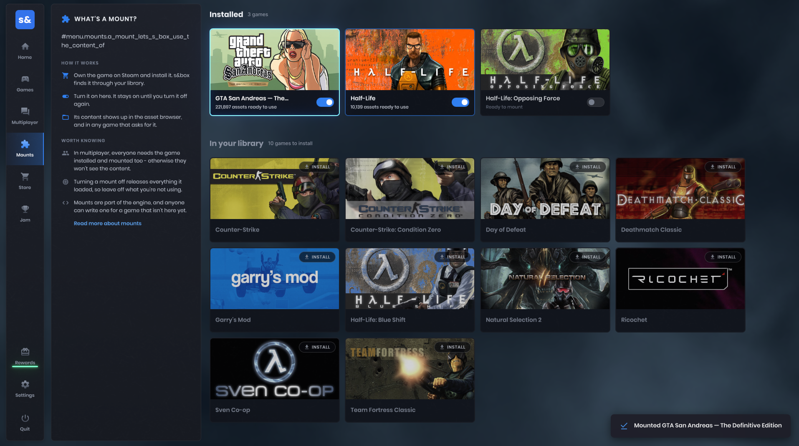
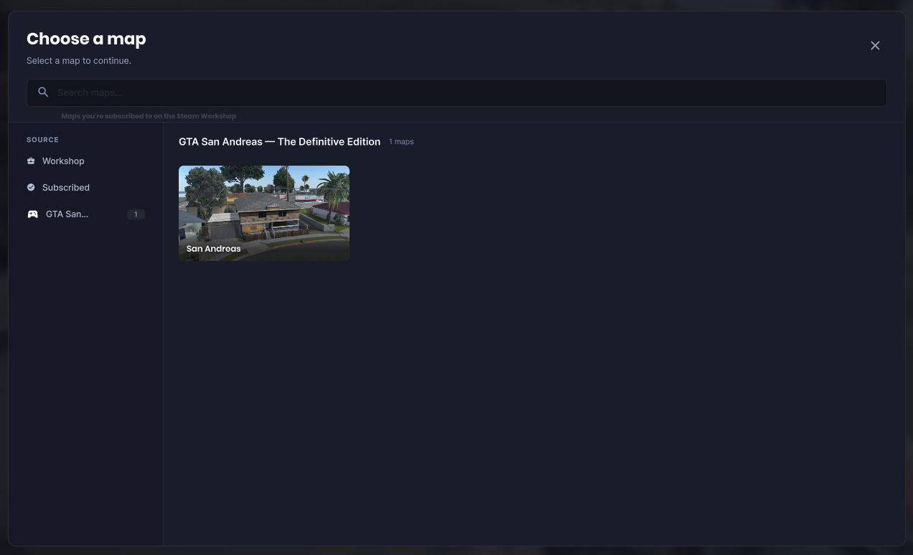

# GTA San Andreas — The Definitive Edition mount for s&box

Explore San Andreas in Sandbox, spawn its characters and vehicles, and browse assets from your installed game. We mount the Definitive Edition because the original game was delisted from Steam.

## Install

You need s&box and GTA San Andreas — The Definitive Edition installed through Steam.

1. **[Download v0.3](https://github.com/crosschainer/sade-mount/releases/download/v0.3/sade-mount.zip)** and close s&box.
2. Extract the ZIP into s&box's `mount` folder: `sbox/mount/sade/sade.dll`.
3. Launch s&box and enable **GTA San Andreas — The Definitive Edition** in **Mounts**.

Find the s&box folder through Steam → Manage → Browse local files. To update, replace the `sade` folder and keep your `sade.json` if you customized it.

## Play

Open **Sandbox → New game → Map**, choose **GTA San Andreas — The Definitive Edition** under **Source**, then select **San Andreas**. You start at Grove Street; the other cities are part of the same streamed world.

Use the spawn menu's **Mounts** tab for characters, vehicles and props:

- CJ, Big Smoke and the gangs animate, speak, fight rivals and retaliate when attacked.
- NPCs have flesh impacts and blood, and support limb-by-limb physgun posing.
- Drive cars and bikes, sail boats, and fly helicopters and planes with original engine sounds.
- Pick up supported loose map props with the physgun. Terrain and buildings stay fixed.
- Curated folders keep useful assets close; **All** contains the complete model collection.

Press **E** beside a vehicle: left for the driver, right for a passenger. Press **E** again to exit. Use **WASD** to drive, **Space** for the handbrake, and **arrow keys** to pitch and roll aircraft. Helicopters use **W/S** to climb and descend.

The map is experimental: water, interiors, traffic and generated navigation are still pending. [Release notes](docs/releases/v0.3.md) cover the current limits.

## See it in Sandbox

Click a preview to download the video.

| Pedestrians and gang fights | Car driving |
| --- | --- |
|  |  |
| **Motorcycle riding** | **Helicopter flight** |
|  |  |

More screenshots

[Settings and building from source](docs/development.md) · [Validation](docs/validation.md) · [Third-party notices](THIRD-PARTY-NOTICES.md)

Mount architecture inspired by [K3rhos/alan_wake](https://github.com/K3rhos/alan_wake).
